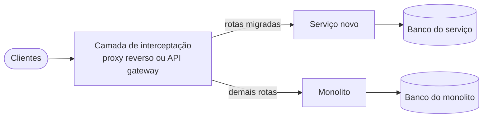

# Adoção de Microsserviços

Guia de referência rápida sobre **quando adotar microsserviços e como conduzir a transição**: critérios de decisão, monolito modular, *monolith first* e *microservices first*, estratégias para sistemas existentes, *Strangler Fig* e antipadrões de adoção.

> [!NOTE]
> Síntese pessoal de conceitos consolidados na literatura de arquitetura de software. As fontes estão nas [referências](#referências). Complementa os guias [Fundamentos de Arquitetura de Software](https://github.com/sidartaoss/fundamentos-arquitetura-software), [Monolitos e Microsserviços](https://github.com/sidartaoss/monolitos-e-microsservicos), [Práticas e Tecnologias para Microsserviços](https://github.com/sidartaoss/praticas-e-tecnologias-para-microsservicos) e [Custos e Riscos de Microsserviços](https://github.com/sidartaoss/custos-e-riscos-de-microsservicos).

## Em resumo

- **A distribuição precisa de justificativa.** Microsserviços são um meio para obter implantação independente, escala seletiva ou autonomia de vários times; sem uma razão concreta, um monolito bem estruturado continua sendo a escolha padrão.
- **Modularidade vem antes da distribuição.** O monolito modular separa código, dados e contratos sem pagar o custo da rede e mantém aberta a opção de extrair serviços.
- **Em sistemas novos, o domínio orienta o ponto de partida.** Um domínio em descoberta favorece começar pelo monolito; domínio conhecido, escala e vários times desde o início podem justificar começar distribuído.
- **Em sistemas existentes, a transição é incremental.** Extrair uma capacidade por vez (*Strangler Fig*) mantém o sistema entregando valor e evita os riscos de uma reescrita completa.
- **A organização muda junto com a arquitetura.** Adoção sem coordenação gera dispersão, e processos herdados do monolito anulam a autonomia que justificaria a mudança.

## 1. A decisão: justificar a distribuição

> "Se você quer uma resposta rápida sobre quando usar microsserviços, é quando você tem uma razão realmente boa." — Sam Newman

A escolha padrão de Newman é uma topologia de implantação simples, um monolito de processo único, ainda que dividido em módulos; entre as razões que considera boas para distribuir estão a implantação independente sem indisponibilidade, o isolamento dos dados e do processamento sobre eles e a autonomia organizacional. Martin Fowler recomenda nem considerar microsserviços a menos que o sistema seja complexo demais para ser gerenciado como monolito. Nos dois casos, o ônus da prova está na distribuição.

| Dimensão | A favor de microsserviços | A favor de um monolito bem estruturado |
|---|---|---|
| Domínio | Capacidades de negócio estáveis, com fronteiras conhecidas | Domínio em descoberta; requisitos e fronteiras ainda mudam com frequência |
| Organização | Vários times no mesmo sistema, com necessidade de autonomia | Um time pequeno, para o qual operar vários serviços seria um fardo |
| Características de qualidade | Partes com perfis muito distintos de carga, disponibilidade ou segurança; operação contínua, como em SaaS | Carga homogênea; sem necessidade de escala seletiva nem de implantação independente |
| Ritmo de mudança | Partes que evoluem em ritmos muito diferentes | O sistema evolui como um todo |
| Maturidade técnica | Testes, deploy e infraestrutura automatizados; observabilidade; experiência com sistemas distribuídos | Práticas básicas de engenharia ainda em consolidação |
| Modelo de entrega | Software operado pela própria organização | Software instalado e operado pelo cliente, que dificilmente terá plataforma e experiência para operar dezenas de serviços |
| Custo | Benefícios esperados superam o *microservice premium* | Orçamento restrito para infraestrutura, ferramentas e pessoas |

- **Tecnologia, sozinha, não justifica a divisão.** Necessidades tecnológicas distintas reforçam uma fronteira que já faz sentido no domínio, mas não a criam.
- **Na dúvida, a opção reversível.** Com sinais mistos, um monolito modular adia a distribuição sem fechar a possibilidade de adotá-la depois.

## 2. Monolito modular

> "Se você não consegue construir um monolito bem estruturado, o que faz você pensar que microsserviços são a resposta?" — Simon Brown

Um monolito modular é uma única unidade de implantação organizada em módulos com fronteiras explícitas: cada módulo é dono da própria lógica e dos próprios dados e expõe apenas um contrato público. Corresponde à topologia que Newman adota por padrão e a uma das formas de executar o *monolith first* descritas por Fowler: projetar o monolito com atenção à modularidade, tanto nas fronteiras das APIs quanto no armazenamento dos dados.

| Fronteira | Regra | Como verificar no ecossistema Java |
|---|---|---|
| Código | Cada módulo expõe uma API pública, como uma fachada (*Facade*), e oculta o restante | Módulos Maven ou Gradle; visibilidade de pacotes; JPMS (`module-info.java`) |
| Dependências | Dependências explícitas entre módulos, sem ciclos | Testes de arquitetura com ArchUnit; verificação de módulos com Spring Modulith |
| Dados | Cada módulo acessa apenas as próprias tabelas, em um esquema próprio | Um usuário de banco por módulo, com permissões restritas ao próprio esquema |
| Integração | Chamadas locais ao contrato público ou eventos de aplicação | Eventos entre módulos, com registro de publicação, no Spring Modulith |

| O monolito modular ganha | E abre mão de |
|---|---|
| Chamadas locais, transações ACID e depuração em um único processo | Escala seletiva: o sistema escala como um todo |
| Um artefato, um pipeline e uma operação | Implantação independente: toda mudança exige reimplantar o sistema inteiro |
| Fronteiras baratas de corrigir: mover código entre módulos é uma refatoração local | Isolamento de falhas e de recursos entre módulos |
| Extração facilitada, com fronteiras e dados já separados | Disciplina contínua: sem verificação automática, as fronteiras se degradam por acoplamento acidental |

Em 2019, a Shopify optou por modularizar seu monolito Rails, com cerca de 3 milhões de linhas de código, em vez de distribuí-lo, mantendo um único pipeline de testes e de implantação.

## 3. Sistemas novos: monolith first ou microservices first

Em um sistema novo (*greenfield*), a questão não é apenas adotar ou não microsserviços, mas quando começar a distribuir.

- **Monolith first.** Martin Fowler, que popularizou a estratégia, aponta como primeira razão o clássico YAGNI (*You Aren't Gonna Need It*): no início, nem a utilidade do produto está comprovada. Além disso, microsserviços só funcionam bem com fronteiras boas e estáveis entre os serviços, e qualquer refatoração de funcionalidades entre serviços é muito mais difícil do que em um monolito. Começar pelo monolito dá tempo para descobrir essas fronteiras; depois, os serviços podem ser extraídos aos poucos, pelas bordas.
- **Microservices first.** Stefan Tilkov contrapõe que, quando o objetivo é uma arquitetura de microsserviços, começar pelo monolito costuma ser exatamente o caminho errado: as partes se acoplam por bibliotecas, objetos de domínio e banco de dados compartilhados, e separá-las depois é extremamente difícil. Ele recomenda subsistemas separados desde o início quando o domínio é bem conhecido e o sistema é grande, idealmente ao construir uma nova versão de um sistema existente.

| | Monolith first | Microservices first |
|---|---|---|
| Ponto de partida | Monolito modular, com fronteiras e dados separados por módulo | Serviços independentes desde a primeira versão |
| Ganha | Tempo para descobrir o domínio; fronteiras baratas de corrigir; operação simples enquanto o produto se valida | Autonomia, implantação e escala independentes desde o início; nenhuma migração futura |
| Risco principal | Modularidade negligenciada, que torna a extração tão difícil quanto em um monolito clássico | Fronteiras erradas, cuja correção exige migrar dados e contratos entre serviços |
| Mais indicado quando | Domínio novo ou instável; time pequeno ou sem experiência com sistemas distribuídos; necessidade de distribuir ainda incerta | Domínio bem conhecido, como na nova versão de um sistema existente; sistema grande desde a origem; plataforma e automação já disponíveis |

As duas posições convergem em um ponto: fronteiras definidas cedo e protegidas. A divergência está em quando pagar o custo da distribuição.

## 4. Sistemas existentes: reescrever, modularizar ou estrangular

Em um sistema já em produção (*brownfield*), a questão é como chegar à arquitetura desejada sem interromper a entrega de valor.

| Estratégia | Como funciona | Quando considerar | Risco principal |
|---|---|---|---|
| Reescrita completa (*big bang*) | Construir o sistema novo do zero e substituir o antigo de uma só vez | Raramente: sistema pequeno o bastante para ser substituído em pouco tempo, ou legado que não admite extração incremental | Funcionalidades congeladas, ou duplicadas nos dois sistemas, até o corte; comportamento não documentado perdido na reescrita |
| Modularização incremental | Tornar explícitas, dentro do próprio monolito, as fronteiras de código, de dependências, de dados e de integração da seção 2 | O sistema atende, mas está difícil de evoluir; ainda não há pressão concreta para distribuir | Não resolve, sozinha, escala seletiva nem implantação independente |
| *Strangler Fig* | Extrair uma capacidade por vez para um serviço novo, desviar o tráfego e remover o código antigo | Partes com pressão concreta para sair do monolito | Convivência prolongada entre o sistema antigo e o novo |

Para Fowler, substituir um sistema sério leva muito tempo, e os usuários não podem esperar por novas funcionalidades; além disso, o comportamento existente é difícil de especificar com precisão. Joel Spolsky chamou a decisão da Netscape de reescrever seu código do zero de o pior erro estratégico que uma empresa de software pode cometer.

**Strangler Fig.** Fowler batizou o padrão em 2004, inspirado nas figueiras-estranguladoras, que crescem sobre uma árvore hospedeira até substituí-la. Sam Newman destaca o mecanismo central: interceptar as chamadas à funcionalidade antiga e redirecioná-las ao serviço novo.

1. **Escolher a capacidade.** Benefício concreto, como escala, ritmo de mudança ou isolamento de falhas, e baixa dificuldade de extração: poucas dependências, dados pouco compartilhados e fronteira já visível no código.
2. **Interceptar.** Posicionar à frente do monolito uma camada capaz de desviar o tráfego.
3. **Implementar.** Construir o serviço com dados próprios, migrando os dados do módulo de origem.
4. **Desviar aos poucos.** Por rota, percentual de tráfego ou grupo de clientes, com *feature toggles* que permitam voltar ao caminho antigo.
5. **Remover e repetir.** Apagar do monolito o código e os dados que deixaram de ser usados e seguir para a próxima capacidade.

| Técnica complementar | Quando ajuda |
|---|---|
| *Branch by Abstraction* (Paul Hammant) | A funcionalidade está no interior do monolito, sem ponto de entrada a interceptar: cria-se uma abstração e uma segunda implementação, que chama o serviço novo, e alterna-se entre as duas |
| *Parallel Run* (Sam Newman) | As implementações antiga e nova executam lado a lado, e os resultados são comparados antes do corte |
| Mudança em paralelo (*expand/contract*, Danilo Sato) | Contratos e esquemas evoluem sem quebrar os consumidores durante a migração |

Newman compara a adoção a um botão de ajuste gradual, e não a um interruptor liga-desliga: distribuir o sistema um pouco mais, observar o efeito e ajustar, também de forma incremental, a estrutura dos times.

## 5. Antipadrões de adoção

Chris Richardson reúne sete antipadrões de adoção de microsserviços:

| Antipadrão | Em que consiste | Contramedida |
|---|---|---|
| *Magic pixie dust* | Acreditar que microsserviços resolverão todos os problemas de desenvolvimento | Identificar o problema concreto e verificar se a distribuição o resolve |
| *Microservices as the goal* | Tratar a adoção como objetivo e medir o sucesso pelo número de serviços | Metas de negócio e de entrega, como lead time e frequência de deploy |
| *Scattershot adoption* | Vários times adotam microsserviços sem nenhuma coordenação | Estratégia comum e diretrizes mínimas compartilhadas |
| *Trying to fly before you can walk* | Adotar uma técnica avançada sem praticar o básico: código limpo, bom design e testes automatizados | Consolidar as práticas de engenharia antes de distribuir |
| *Focusing on technology* | Concentrar-se na tecnologia, em geral na infraestrutura de implantação, e negligenciar a decomposição em serviços | Começar pela modelagem do domínio e das fronteiras |
| *More the merrier* | Criar, de propósito, uma arquitetura de granularidade muito fina | Serviços dimensionados por capacidade de negócio |
| *Red flag law* | Manter o processo de desenvolvimento e a estrutura organizacional da era do monolito | DevOps e times multifuncionais, fracamente acoplados |

O nome *red flag law* remete às leis de trânsito do século XIX, nos Estados Unidos e no Reino Unido, que exigiam um pedestre agitando uma bandeira vermelha à frente de cada automóvel. Richardson cita como exemplos os silos funcionais, como times separados de desenvolvimento e de QA, e as implantações restritas a janelas de manutenção nos fins de semana. Em *Accelerate*, Nicole Forsgren, Jez Humble e Gene Kim relatam que aprovações externas de mudanças se correlacionam com entregas menos frequentes e mais lentas, sem ganho de estabilidade.

Entre os dois extremos, a governança equilibrada define poucas regras e as verifica de forma automatizada, por exemplo com *fitness functions*, propostas por Neal Ford, Rebecca Parsons e Patrick Kua para verificar continuamente características arquiteturais:

| | Dispersão (*scattershot adoption*) | Governança equilibrada | Processos herdados (*red flag law*) |
|---|---|---|---|
| Decisões | Cada time decide sozinho protocolos, ferramentas e práticas | Poucas diretrizes obrigatórias (contratos, segurança, observabilidade) e um caminho padrão com suporte da plataforma | Decisões centralizadas e silos funcionais, como na era do monolito |
| Verificação | Inexistente | Automatizada no pipeline; exceções registradas em ADR | Manual, em aprovações externas e janelas de mudança |
| Efeito | Operação heterogênea e cara | Autonomia dentro de limites explícitos | Autonomia anulada por filas e esperas |

## 6. Exemplo aplicado: plataforma de venda de ingressos

A plataforma dos guias anteriores combina um monolito modular (eventos, catálogo e contas) a serviços de reservas, pagamentos e notificações ([detalhes](https://github.com/sidartaoss/custos-e-riscos-de-microsservicos#8-exemplo-aplicado-plataforma-de-venda-de-ingressos)). Essa arquitetura não foi desenhada de uma só vez: resulta de um *monolith first* seguido de extrações incrementais, cada uma motivada por uma pressão concreta.

| Etapa | Gatilho | Decisão | Trade-off |
|---|---|---|---|
| Lançamento | Domínio em descoberta (lotes, meia-entrada, mapas de assentos) e um único time | Monolito modular com seis módulos (eventos, catálogo, contas, reservas, pagamentos e notificações), um esquema por módulo e dependências verificadas em testes | Picos de venda exigem escalar o sistema inteiro |
| Reservas | A abertura das vendas concentra em minutos o tráfego de semanas | Primeira extração: o API gateway passa a encaminhar as rotas de reserva ao serviço novo, e o esquema do módulo migra para um banco próprio | A consistência com pagamentos passa a exigir coordenação explícita |
| Pagamentos | A lentidão dos gateways externos ocupava recursos de todo o processo | Extração com *feature toggle* por percentual de compras e retorno imediato ao fluxo antigo | Conciliação e idempotência entre serviços |
| Notificações | E-mails e *push* não podem bloquear a compra | Consumo assíncrono de eventos; em *parallel run*, o serviço novo gera as mensagens sem enviá-las, para comparação com as do monolito | Entrega eventual; filas a monitorar |
| Eventos, catálogo e contas | Carga previsível, atendida com cache; dados pessoais concentrados em contas | Permanecem no monolito modular: o benefício não compensa o custo da extração | Parte do sistema segue acoplada |

A estrutura dos times acompanhou as extrações, no ritmo gradual que Newman recomenda: o time inicial deu origem aos times de Descoberta e de Compra na primeira extração, e o de Pós-venda surgiu com as notificações ([times](https://github.com/sidartaoss/praticas-e-tecnologias-para-microsservicos#9-exemplo-aplicado-plataforma-de-venda-de-ingressos)). Para evitar tanto a dispersão quanto os processos herdados, a governança se limita a poucas diretrizes: contratos OpenAPI e AsyncAPI versionados, com testes de contrato no pipeline; telemetria com OpenTelemetry; o chassi interno como caminho padrão; e, em vez de aprovações externas para criar serviços ou implantar, *fitness functions* no pipeline, como as dependências permitidas entre módulos, a compatibilidade dos contratos e o p95 abaixo de 300 ms nos testes de carga.

Cada etapa da trajetória, com o gatilho que a motivou e as alternativas descartadas, deve ser registrada em um ADR: o registro explica por que cada parte saiu do monolito, ou permaneceu nele, e indica quando revisitar a decisão.

## Referências

- Sam Newman — *Monolith to Microservices* (O'Reilly, 2019) e *Building Microservices*, 2ª ed. (O'Reilly, 2021); com Martin Fowler, [Moving to Microservices](https://gotopia.tech/bookclub/episodes/moving-to-microservices-with-sam-newman-and-martin-fowler) (GOTO Book Club, 2020)
- Martin Fowler — [MonolithFirst](https://martinfowler.com/bliki/MonolithFirst.html) e [Microservice Premium](https://martinfowler.com/bliki/MicroservicePremium.html) (2015), [Strangler Fig Application](https://martinfowler.com/bliki/StranglerFigApplication.html) (2004, revisado em 2024) e [Branch By Abstraction](https://martinfowler.com/bliki/BranchByAbstraction.html) (2014); Danilo Sato — [ParallelChange](https://martinfowler.com/bliki/ParallelChange.html) (2014)
- Stefan Tilkov — [Don't start with a monolith](https://martinfowler.com/articles/dont-start-monolith.html) (2015)
- Simon Brown — [Modular Monoliths](https://devnexus.com/archive/devnexus2016/presentations/5920.html) (DevNexus, 2016)
- Chris Richardson — [Microservices adoption anti-patterns](https://microservices.io/microservices/general/2018/11/04/potholes-in-road-from-monolithic-hell.html) (2018) e [Red flag law](https://microservices.io/post/antipatterns/2019/06/07/antipattern-red-flag-law.html) (2019)
- Joel Spolsky — [Things You Should Never Do, Part I](https://www.joelonsoftware.com/2000/04/06/things-you-should-never-do-part-i/) (2000)
- Kirsten Westeinde — [Deconstructing the Monolith](https://shopify.engineering/deconstructing-monolith-designing-software-maximizes-developer-productivity) (Shopify Engineering, 2019)
- Nicole Forsgren, Jez Humble e Gene Kim — *Accelerate* (IT Revolution, 2018)
- Neal Ford, Rebecca Parsons e Patrick Kua — *Building Evolutionary Architectures* (O'Reilly, 2017)
- [Spring Modulith](https://spring.io/projects/spring-modulith) e [ArchUnit](https://www.archunit.org/)
